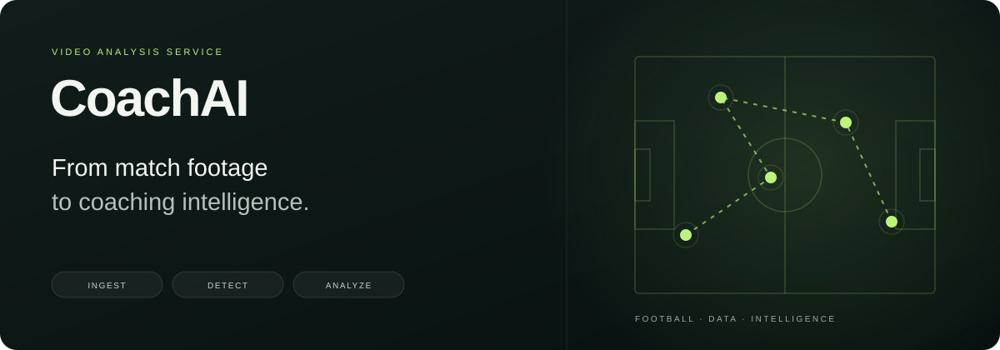
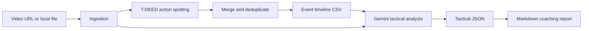

<p align="center">
  
</p>

<p align="center">
  <a href="https://github.com/KhalidD0nc/Video-Agent-Analysis-Service/actions/workflows/ci.yml"></a>
  
  
  
  <a href="LICENSE"></a>
</p>

<p align="center"><strong>Turn match footage into an event timeline, tactical findings, and a coaching report.</strong></p>
<p align="center">
  <a href="#how-it-works">Architecture</a> ·
  <a href="#run-locally">Quick start</a> ·
  <a href="docs/API.md">HTTP API</a> ·
  <a href="CONTRIBUTING.md">Development workflow</a> ·
  <a href="https://github.com/KhalidD0nc/offside-frontend">Offside dashboard ↗</a>
</p>

CoachAI combines temporal action spotting with multimodal analysis. T-DEED models identify candidate football events; a cleaning stage merges them into a timestamped timeline; Gemini uses the video and timeline to produce structured tactical findings and a Markdown report.

The same `coachai` package powers a local CLI and a Modal HTTP adapter. This repository contains the analysis service; [Offside](https://github.com/KhalidD0nc/offside-frontend) is the companion coaching dashboard.

## What it produces

| Output | Purpose |
| --- | --- |
| `timeline.csv` | Cleaned events with timestamps, labels, and confidence values |
| `tactical_report.json` | Tactical analysis returned by Gemini |
| `analysis.md` | A narrative coaching report |
| Stage timings | Download, inference, cleaning, and reporting durations |

The API also accepts `primary_team` to frame reports from one team's coaching perspective. Generated reports depend on video quality, model detections, and the reporting model; review findings against the footage.

## How it works



- **Ingestion:** local files or downloads through `yt-dlp`.
- **Inference:** `SoccerNet_small` and `SoccerNetBall_challenge1`, with confidence filtering and non-maximum suppression.
- **Cleaning:** merge detections from both models and deduplicate nearby events.
- **Reporting:** two Gemini calls produce tactical JSON and a narrative report.
- **Serving:** asynchronous submission and polling through Modal; models are loaded when a GPU container starts.

See [the architecture notes](docs/ARCHITECTURE.md) for module boundaries and the dashboard integration.

## Run locally

### 1. Prepare the environment

Use **Python 3.11** and install **FFmpeg** for video downloads and processing. CUDA is used when available; the current device selection otherwise falls back to CPU. Apple MPS is not selected by the current runner.

```bash
git clone https://github.com/KhalidD0nc/Video-Agent-Analysis-Service.git
cd Video-Agent-Analysis-Service
python3.11 -m venv .venv
source .venv/bin/activate
python -m pip install --upgrade pip
python -m pip install -r requirements-mac.txt
python -m pip install -e .
cp .env.example .env
```

On Windows, activate with `.venv\Scripts\Activate.ps1`. For the pinned NVIDIA CUDA 12.1 stack, use `requirements.txt` instead of `requirements-mac.txt`.

Set `GEMINI_API_KEY` in `.env` for report generation. Use `--skip_gemini` for event extraction without Gemini calls.

### 2. Prepare the model directory

The loader expects checkpoints, configurations, and class labels under one root. From a full clone:

```bash
mkdir -p weights/class_data/soccernet weights/class_data/soccernetball
cp -R checkpoints config weights/
cp data/soccernet/class.txt weights/class_data/soccernet/class.txt
cp data/soccernetball/class.txt weights/class_data/soccernetball/class.txt
```

Expected layout:

```text
weights/
├── checkpoints/
│   ├── SoccerNet/SoccerNet_small/checkpoint_best.pt
│   └── SoccerNetBall/SoccerNetBall_challenge1/checkpoint_best.pt
├── config/
│   ├── SoccerNet/SoccerNet_small.json
│   └── SoccerNetBall/SoccerNetBall_challenge1.json
└── class_data/
    ├── soccernet/class.txt
    └── soccernetball/class.txt
```

### 3. Analyze a clip

```bash
# Extract events from a local video, without Gemini reporting
python run_local.py --video_path ./match.mp4 --weights_dir ./weights --skip_gemini

# Generate the timeline and reports using the configured Gemini key
python run_local.py --video_path ./match.mp4 --weights_dir ./weights

# Download a video before running the pipeline
python run_local.py --video_url "https://www.youtube.com/watch?v=VIDEO_ID" --weights_dir ./weights
```

Final artifacts are written to `final_output/`. Intermediate predictions and CSV files use `inference_output/` and `results_in_csv/`. Model selection, thresholds, and the Gemini model identifier live in [`src/coachai/config.py`](src/coachai/config.py).

## HTTP service

| Endpoint function | Method | Role |
| --- | --- | --- |
| `submit` | POST | Start an asynchronous job and return `job_id` |
| `status` | GET | Retrieve a pending, completed, or failed job |
| `analyze` | POST | Run a synchronous analysis for short clips |
| `health` | GET | Return service metadata and configured models |

Modal exposes separate endpoint URLs for these functions. [API documentation](docs/API.md) includes request/response examples and deployment prerequisites. Deployments are explicit; a Git branch does not deploy a service automatically.

## Repository map

```text
src/coachai/
├── ingestion/          # Video downloads
├── inference/          # Model loading, inference, and post-processing
├── analysis/           # Cleaning and timeline conversion
├── reporting/          # Gemini client and prompts
├── config.py           # Shared model and runtime configuration
└── pipeline.py         # Pipeline orchestration
model/                  # T-DEED implementation
config/                 # Dataset/model configurations
run_local.py            # Local CLI adapter
modal_app.py            # Modal GPU and HTTP adapter
tests/                  # Offline package smoke tests
docs/                   # Architecture and API reference
```

## Development and checks

```text
feature/* → development → staging → main
```

`development` integrates changes, `staging` holds release candidates, and `main` is the stable reference. These branches organize source changes; deployed environments require separate credentials and infrastructure configuration.

Run the existing offline suite without downloading PyTorch or using API credentials:

```bash
python -m pip install -r requirements-dev.txt
python -m pip install -e .
python -m pytest tests/ -v
```

CI runs these checks on pushes and pull requests targeting all three branches. Live endpoint checks are a separate **manual** workflow because they can consume GPU and Gemini usage. Offline smoke tests do not validate model quality or a deployed endpoint. See [CONTRIBUTING.md](CONTRIBUTING.md).

## Credits and license

CoachAI originated as a graduation project at the College of Computer and Information Sciences, Al Imam Mohammad Ibn Saud Islamic University. The original project documentation credits **Marwan**.

The action-spotting implementation builds on [T-DEED](https://github.com/arturxe2/T-DEED) by Artur Xarles, Sergio Escalera, Thomas B. Moeslund, and Albert Clapés ([CVsports 2024 paper](https://arxiv.org/abs/2404.05392)). Preserve the upstream attribution when reusing this work.

See [LICENSE](LICENSE) for GPL-3.0 and [LICENSE E2E-Spot](LICENSE%20E2E-Spot) for the included E2E-Spot notice.
