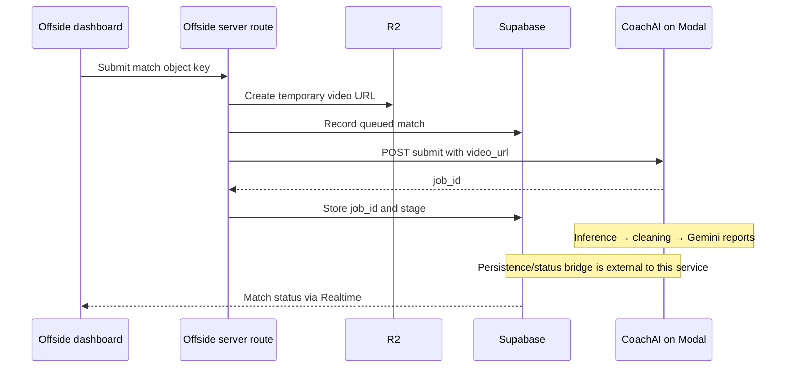

# Architecture

## One pipeline, two adapters

`run_local.py` loads local environment values, parses CLI arguments, and saves artifacts. `modal_app.py` owns the Modal image, GPU lifecycle, and HTTP functions. Both delegate analysis to `coachai.pipeline.run()`.

| Module | Responsibility |
| --- | --- |
| `ingestion/downloader.py` | Download input footage |
| `inference/engine.py` | Load T-DEED models and run inference |
| `inference/postprocess.py` | Turn scores into filtered events |
| `analysis/cleaner.py` | Merge and deduplicate model events |
| `analysis/timeline.py` | Convert frame indices into timestamps and CSV |
| `reporting/gemini_client.py` | Upload footage and request both reports |
| `reporting/prompts.py` | Tactical JSON and narrative prompts |
| `config.py` | Model names, frame settings, thresholds, and directories |

The default input resolution is 796 × 448 at 25 FPS. Dataset-specific strides and inference settings are defined in code. Keep these aligned with the pretrained models.

## Dashboard boundary

The service returns artifacts through its job result. It does not contain the dashboard's Supabase persistence worker. The checked-in frontend stores the job identifier and subscribes to database changes; deployment needs a separate bridge to poll Modal and persist results.

## Runtime details

- Local inference selects CUDA if available and otherwise CPU.
- Modal requests T4, L4, or A10 GPU capacity and reuses loaded models within a container.
- The local CLI writes `final_output/`; the HTTP service returns the corresponding content as strings.
- `primary_team` is accepted by the pipeline and HTTP adapter; the local CLI currently exposes no corresponding flag.
- `--skip_gemini` retains event extraction and omits report generation.

## Verification boundaries

The offline smoke suite checks imports, prompt rendering, timestamps, empty-input cleaning, and an empty-event NMS case. It does not exercise checkpoint compatibility, full video inference, reporting quality, or GPU deployment. Manual live checks are separate from CI.
